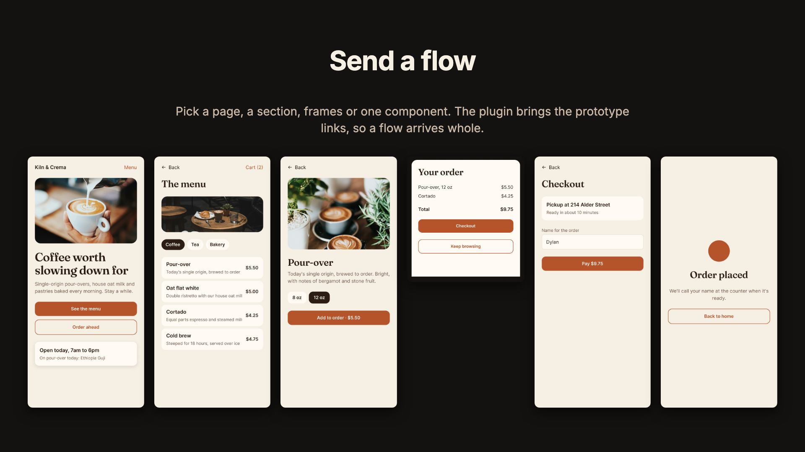
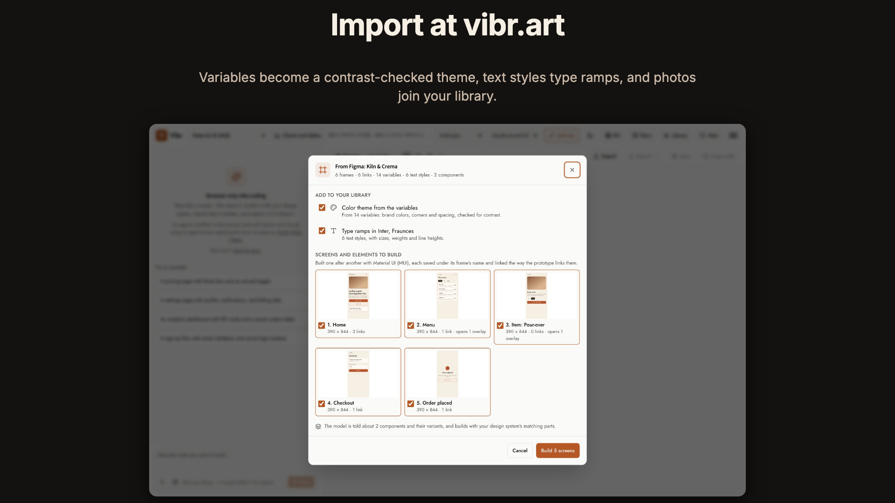
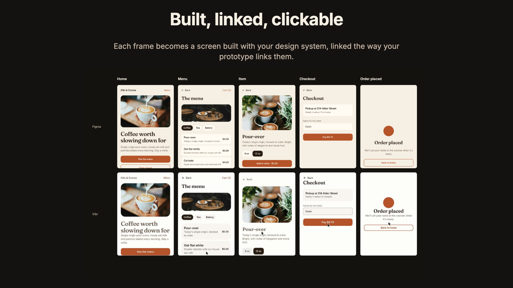

# Send to Vibr

A Figma plugin that brings your design into [Vibr](https://vibr.art), the browser design agent. It reads the file you have open (variables, text styles, components, frames and prototype links) and saves it as one `.vibr-figma.json` file. Vibr imports that file and builds each frame as a working screen with your design system and your model, linked the way your prototype links them.



Works on every Figma plan, including Starter. It has no network access: nothing leaves Figma except the file you save.

## Install

Send to Vibr is in review for Figma Community. Until it's approved, install it from this repository. You need the Figma desktop app.

1. Download this repository ([Code → Download ZIP](https://github.com/beneficialmedia/vibr-figma-plugin/archive/refs/heads/main.zip)) and unzip it, or clone it.
2. In Figma desktop, open a design file, then **Plugins → Development → Import plugin from manifest…**
3. Choose `manifest.json` in the folder.

The plugin now appears under **Plugins → Development → Send to Vibr**. The built plugin (`code.js`, `ui.html`) is checked in, so there's nothing to build.

## Use

1. **Choose what to send.** Select a page, a section, frames or a single element, or choose **Whole file** at the top of the plugin. It lists what it will send.
   - Whole file: each page's prototype flows, or else its screens. Cover, thumbnail and divider pages are skipped.
   - A page with nothing selected: its flows, or else every screen on it.
   - A section: its frames. A frame: that screen.
   - An element (a component, an instance or any layer): built on its own as a reusable component.
2. **Choose what comes along:** screens with layout and prototype links (and the frames they link to, so a flow arrives whole), photos cropped as your design shows them, variables, text styles and shadows, and components with their variants.
3. **Save file for Vibr.** You get a file ending in `.vibr-figma.json`. **Copy** puts the same thing on the clipboard.
4. **Import it into Vibr.** In the request box, select **+ → Import from Figma** and pick the file, or drop or paste it. Vibr shows what it will make before it builds anything.



## What becomes what

| In Figma | In Vibr |
|---|---|
| Color variables | A color theme, with light and dark roles checked for contrast |
| Radius and spacing variables, shadow styles | The theme's corners, spacing unit and shadows |
| Text styles | A type ramp for each font family |
| Image fills | Photos in your library, named after their layers |
| Frames | Screens, built from the frame's picture and an outline of its layers |
| Prototype links | Links between screens; overlays become dialogs or sheets |
| Components | Your design system's matching parts, with their variants |

After a run, Vibr measures each screen against its frame, repairs the differences, and leaves any that remain on the screen as open feedback.



One file holds up to 12 screens and elements, 12 photos, 80 components and 1,500 variables. For a large file, send a page or a selection.

Full guide: [vibr.art/docs/import-from-figma](https://vibr.art/docs/import-from-figma)

## Privacy

- `manifest.json` sets `networkAccess` to `none`, so Figma blocks every request the plugin could make. It reads the open file only when you run it, and saves only what you choose.
- Vibr checks the file before reading it: text comes in as plain text, every value is checked and limited in size, and photos are redrawn, which strips their metadata. Nothing in the file runs.

## Build from source

The source is `src/code.ts` (the plugin) and `src/figma-bundle.ts` (the file format, version 1). `ui.html` is the plugin's panel.

```sh
npm install
npm run build
```

`build.mjs` type-checks against Figma's plugin typings and writes `code.js`. The source imports types only, so it needs no bundler, and the output matches the build submitted to Figma Community.

## Related

- [vibr-mcp](https://www.npmjs.com/package/vibr-mcp): lets Claude Code and other MCP clients import these files into Vibr for you.

## License

MIT
